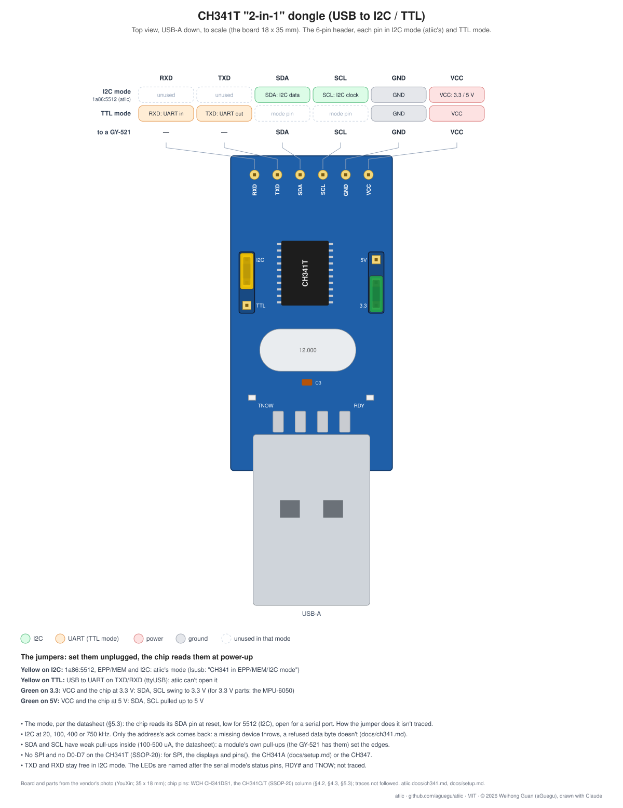
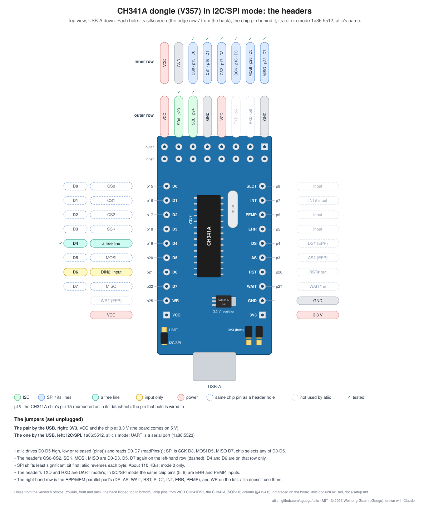

# CH341 as the I2C and SPI bus

WCH's CH341 (A/B/F/T) strapped to its I2C mode enumerates as `1a86:5512`, a
vendor-class USB device: no serial port, its I2C stream commands on bulk
endpoint 2 (`src/adapters/ch341/protocol.js`). atiic talks to it over WebUSB,
in a browser (`navigator.usb`, Chromium) or in Node (the `usb` package's
WebUSB, `src/adapters/ch341/node.js`).

```js
import { openCh341 } from 'atiic/adapters/ch341/node';

const bus = await openCh341(); // 100 kHz; 20000, 400000, 750000 too
console.log(await bus.scan()); // the 7-bit addresses that ack, e.g. [ 104 ]: 0x68
const [whoAmI] = await bus.writeRead(0x68, [0x75], 1); // a register read
await bus.write(0x68, [0x6b, 0x00]); // a register write
await bus.close();
```

In a browser (Chromium; WebUSB):

```js
import Ch341, { FILTERS } from 'atiic/adapters/ch341';

const device = await navigator.usb.requestDevice({ filters: FILTERS });
const bus = await new Ch341(device).open(400000);
```

The device drivers take any bus with `scan`, `write`, `read` and
`writeRead`; none of them knows the CH341.



The CH341T (SSOP-20) has I2C only: no D0-D7, so no SPI and no `pins()`
(CH341DS1's sync-serial table has no column for it). Those take the CH341A
(SOP-28), as on [setup.md](setup.md)'s second bench:

 Its high-speed successor, the
CH347, compared on I2C: [i2c_adapters.md](i2c_adapters.md).

## Digital lines: D0-D5

The CH341's parallel data lines D0-D5 (chip pins 15-20 on the CH341A; D0-D2
are also SPI's CS0-CS2) can be driven high or low, or released back to an
input, by its UIO stream command (as flashrom drives
its chip selects). D6 and D7 are inputs only.

```js
await bus.pins({ D0: true }); // D0 driven high; the others as they were
await bus.pins({ D1: false, D0: null }); // D1 low; D0 released
```

They hold over a USB reset (atiic resets the CH341 on open in Node), but
the CH341 forgets them when unplugged: drive them again after
opening it. Tried on a CH341A on r8845 (D0 to a BMX055's PS pin).


Reading them: `readPins()` returns D0-D7's levels (`{ D0: true, ... }`),
driven or not, by the status read (0xA0, its first byte; WCH's DLL's
`CH341GetInput`). D6 and D7 are inputs only; D0-D5 read their outside once
released (`null`). Used for an e-paper's BUSY on D4. DS1 lists built-in
pull-ups for D6 and D7 (DIN, DIN2) only: a released D0-D5 left open isn't
known to read high.

## SPI: SCK, MOSI, MISO

In the same I2C/SPI mode the CH341 is an SPI master too: SCK is D3, MOSI D5,
MISO D7, and the chip selects are any of D0-D5 driven by `pins()` (CS0-CS2
are D0-D2 on the header). Mode 0, full duplex: `spi()` returns the bytes
read on MISO while it sent.

The CH341 shifts LSB first, and nothing changes that: atiic reverses each
byte, so devices get MSB first. WCH's DLL offers MSB first (bit 7 of
`CH341SetStream`'s mode), but its wire command, `mCH341A_CMD_I2C_STM_SET`
(0x60) in WCH's `CH341DLL.H`, has only bit 2 (SPI's dual I/O) and bits 1-0
(the I2C speed): the DLL reverses in software too. On r8845 every stream
mode 0x60-0x73 sent LSB first (read off the bit MOSI holds after a
transfer).

```js
await bus.pins({ D2: false }); // the device's CS low
const back = await bus.spi([0x9f, 0, 0, 0]);
await bus.pins({ D2: true });
```

A packet carries 31 bytes; the CH341 answers each with what it read, and
stalls if those replies aren't read, so atiic reads them while it sends
(16 packets a round). About 110 KB/s (WCH's DLL, `CH341StreamSPI4`: "about
68 KB"): a full 80x160 RGB565 screen (25,600 bytes) in 235 ms on r8845. I2C and SPI share the chip, not the lines (SCL
and SDA are separate pins), so both buses can be wired at once.

Tried on a CH341A on r8845 with an ST7735S display (`src/devices/st7735s.js`).

## Tests

- `npm test`: the host tests, no hardware (`test/host/`)
- `npm run test:board`: on a bench with a CH341 (`test/board/`; r8845).
  Each test runs with what it finds: I2C chips by their ID registers, a
  BMX055's PS line by `BENCH_PS`, an ST7735S by `BENCH_ST7735`
  (`res=D0,dc=D1,cs=D2`), set in `.env.local`

## Linux

The device node is root's; a udev rule gives it to a group the user is in
(`uucp` on r8845):

```
SUBSYSTEM=="usb", ATTRS{idVendor}=="1a86", ATTRS{idProduct}=="5512", GROUP="uucp", MODE="0660"
```

in `/etc/udev/rules.d/99-ch341.rules`, then `udevadm control --reload` and
`udevadm trigger` (or replug). The kernel's `spi-ch341` binds to the same
device; opening it from userspace detaches that driver until the next replug.

## What it can't do

- Data bytes written aren't checked for an ack: the CH341 replies an ack
  only for a byte sent alone, which atiic uses for each address byte. A
  missing device throws (`no ack from 0x..`); a device refusing a data byte
  doesn't.
- Master only; SCL at 20, 100, 400 or 750 kHz.

## Sources

- `CH341DS1.PDF`, `CH341DS2.PDF` (WCH, version 3C): the chip and its
  Windows DLL; the USB commands aren't in them. Fetch them from
  <https://file.wch.cn/download/file?id=16> and `?id=24`.
- WCH's CH341 EVT (<https://file.wch.cn/download/file?id=60>): its
  `CH341PAR/VC/CH341DLL.H` (GB18030) names the USB commands (0xA0 status,
  0xA8 SPI, 0xAA I2C and its stream commands, 0xAB UIO) with their bits,
  and the DLL's calls with their timing notes.
- The commands as the open drivers send them (flashrom's `ch341a_spi.c`,
  the out-of-tree Linux `i2c-ch341`), checked on a CH341T against an
  MPU-6050 (`test/board/ch341.test.js`).
