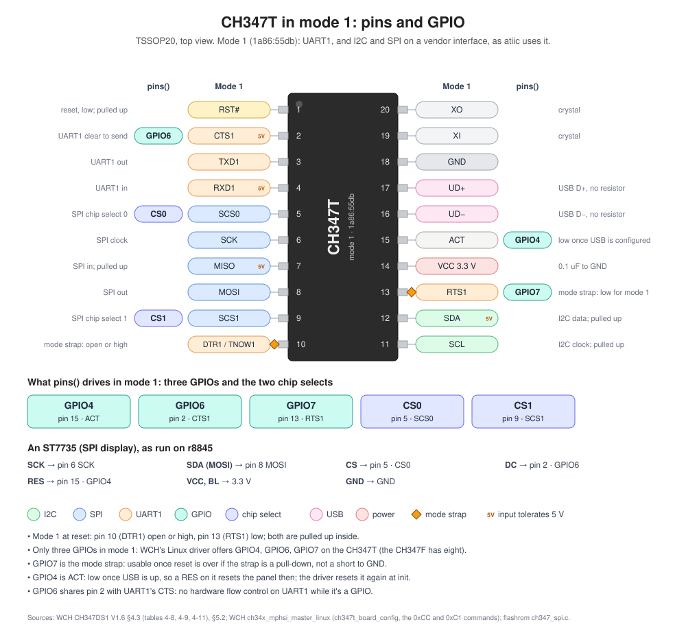
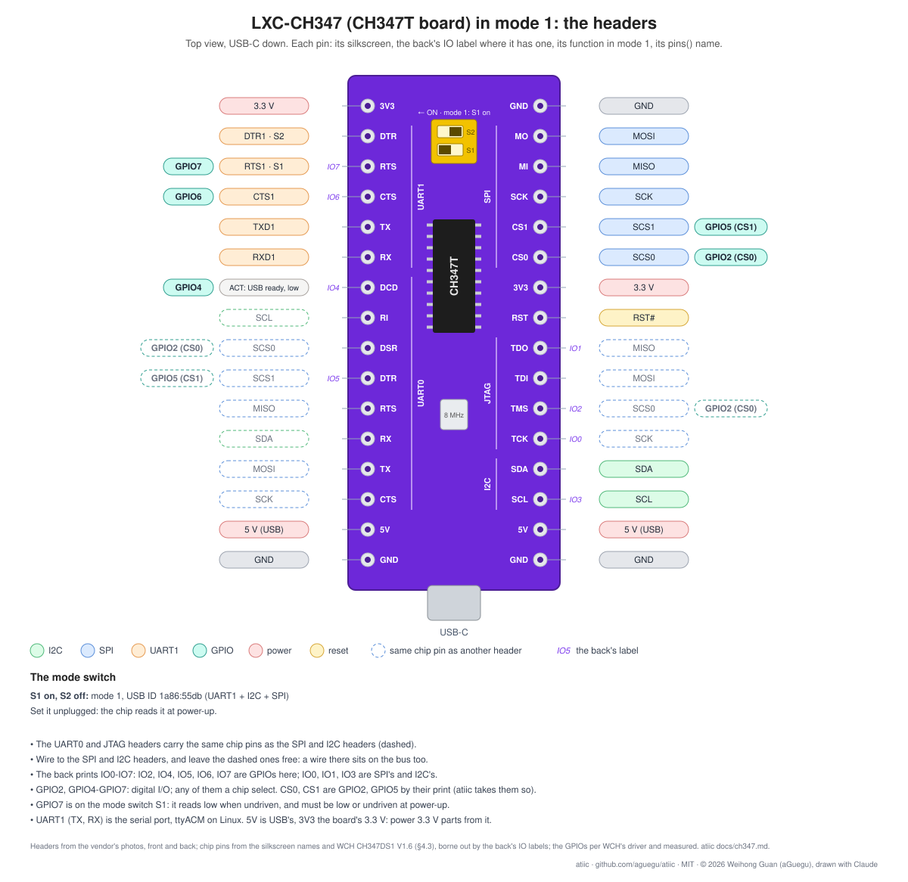

# CH347 as the I2C bus

WCH's CH347 is the CH341's high-speed (480 Mbit/s) successor. atiic talks
to it as it does to the CH341: over WebUSB, in a browser (`navigator.usb`,
Chromium) or in Node (the `usb` package's WebUSB,
`src/adapters/ch347/node.js`): I2C, SPI, and its GPIOs and chip selects
as `pins()`.

```js
import { openCh347 } from 'atiic/adapters/ch347/node';

const bus = await openCh347(400000); // 100 kHz by default; 20000, 750000 too
console.log(await bus.scan()); // e.g. [ 104 ]: an MPU-6050 at 0x68
const [whoAmI] = await bus.writeRead(0x68, [0x75], 1);
await bus.close();
```

In a browser (Chromium; WebUSB):

```js
import Ch347, { FILTERS } from 'atiic/adapters/ch347';

const device = await navigator.usb.requestDevice({ filters: FILTERS });
const bus = await new Ch347(device).open(400000);
```

The device drivers take it as they take the CH341: none of them knows
which adapter is under it. The two compared on I2C:
[i2c_adapters.md](i2c_adapters.md).

## Which CH347, which mode



On r8845 the CH347T is on a development board, the LXC-CH347 (芯路城:
purple, USB-C, an 8 MHz crystal, a two-way mode switch, two 16-pin rows).
Its headers are named for every mode at once, so in mode 1 several carry
the same chip pin: the UART0 and JTAG headers are the SPI's and I2C's lines
again. The back labels eight headers IO0-IO7, each on the header whose chip
pin is that GPIO in the datasheet's mode 0 table: the mapping below holds.
In mode 1 only IO4, IO6 and IO7 are GPIOs (WCH's driver).



The CH347T picks one of four modes at reset from two pins (CH347DS1 §5.2):

| Mode | DTR1 (pin 10), RTS1 (pin 13) | What it offers | PID |
|---|---|---|---|
| 0 | high, high | two serial ports | 55DA |
| **1** | high, **low** | a serial port + I2C and SPI on a vendor interface | **55DB** |
| 2 | **low**, high | a serial port + I2C and SPI as HID (no driver) | 55DC |
| 3 | low, low | a serial port + JTAG | 55DD |

atiic takes **mode 1**, and the **CH347F** (55DE, no modes: two serial
ports, I2C, SPI, JTAG and SWD all at once), whose I2C and SPI are on a
vendor interface too. The adapter finds that interface by its class (255)
and its bulk endpoints, so it doesn't depend on the interface number: 2 on
a CH347T in mode 1, after the serial port's 0 and 1.

Mode 2 is HID: browsers reach it through WebHID, not WebUSB, so it would
be a transport of its own (its draw: no driver to install on Windows). Not
done.

On r8845 (CH347T, mode 1, `lsusb -v`): interface 0 CDC (its interrupt
endpoint 3), interface 1 CDC data (bulk 4), interface 2 vendor class:
bulk 6 out and in (512 bytes), interrupt 5 in. Linux binds `cdc_acm` to the
serial port (`ttyACM0`) and nothing to interface 2.

## The I2C stream, as the CH347 answers it

WCH documents only its Windows DLL (`CH347DLL_EN.H`: `CH347I2C_Set`,
`CH347StreamI2C`); the EVT package (`CH347EVT.ZIP`) holds that DLL's
headers and a Windows demo, not the USB packets. The commands are the
CH341's I2C stream (the header's own `mCH341A_CMD_I2C_STM_*`): a packet
starts with 0xAA and holds STA 0x74, STO 0x75, OUT 0x80|n, IN 0xC0|n, SET
0x60|speed, END 0x00. How the CH347 answers them was measured on a CH347T
in mode 1 on r8845 with an MPU-6050 on its bus (2026-11-07):

| Sent | Replied | Read |
|---|---|---|
| `aa 61 00` | nothing | SET: 100 kHz, as on the CH341 |
| `aa 74 81 d0 75 00` | `01` | the MPU-6050's address acked |
| `aa 74 81 20 75 00` | `00` | nobody at 0x10: not acked |
| `aa 74 82 d0 75 74 81 d1 c0 75 00` | `01 01 01 68` | WHO_AM_I: three acks, then 0x68 |
| `aa 74 80 d0 81 75 74 80 d1 c0 75 00` | `01 00 00 ff` | the same with OUT 0: broken |

What differs from the CH341:

- **Every byte written replies its ack**, 0x01 acked, 0x00 not. The
  CH341 replies only for OUT 0's single byte, and the other way round (0x80
  set when nacked). So the CH347 adapter checks every byte: a byte a device
  refuses throws (`no ack from 0x68 for byte 3`), where the CH341 checks
  only the address.
- **OUT 0 is never sent.** On the CH341 it writes one byte and replies its
  ack; on the CH347 it broke the transaction every time (above), the next
  one fine again. Writes go by OUT n, n 1-63.
- **A packet is up to 512 bytes, and so is its reply** (the bulk endpoints'
  size at high speed; the CH341's are 32). A 509-byte read came back as one
  512-byte reply (its three acks and the data); a 603-byte reply faulted the
  transfer. Longer reads are split into packets, each with whole commands.
- **Reads as on the CH341:** IN n reads n bytes, each acked; IN 0 reads one,
  nacked, for a read's last byte. IN 1 for a last byte acks it, and the
  device holds the bus past the stop: the next transaction went wrong.

The speeds are the CH341's four (`CH347I2C_Set`): 20, 100, 400 and
750 kHz. The header also names a clock-stretch switch and the pins' drive
mode (`CH347I2C_SetStretch`, `CH347I2C_SetDriverMode`); their commands
aren't known yet.

## SPI and pins

```js
const bus = await openCh347(100000, { spiHz: 15e6 }); // SPI 7.5 MHz by default, mode 0
await bus.pins({ CS0: false, GPIO6: true }); // a chip select low, a GPIO high
const back = await bus.spi([0x9f, 0, 0, 0]); // full duplex: MISO's bytes back
await bus.pins({ CS0: true });
```

The device drivers that take `spi()` and `pins()` (the displays, the
e-papers, `SpiRegisters`) run on it as on the CH341; only the line names
differ. An ST7735S ran its whole board test on r8845's CH347T so (its card
checked by eye):

| ST7735 | CH347T (mode 1) |
|---|---|
| SCK | pin 6 SCK |
| SDA (MOSI) | pin 8 MOSI |
| CS | pin 5 SCS0: `cs=CS0` |
| DC | pin 2: `dc=GPIO6` |
| RES | pin 15 ACT: `res=GPIO4` |

(`BENCH_ADAPTER=ch347 BENCH_ST7735=res=GPIO4,dc=GPIO6,cs=CS0`.) RES ran on
CS1 first (pin 9: a chip select not used as one is an output too); on
GPIO4 it leaves CS1 for a second SPI device. Seen working: GPIO4 held low
for 6 s, the panel went dark, then re-inited it showed red (the user). ACT
goes low once USB is configured, resetting the panel then: harmless, the
driver's `init()` resets it again. GPIO7 (pin 13) wasn't taken for RES:
it's the mode strap, and on a board whose switch shorts it to GND it can't
be driven high.

The commands come from the open drivers, as the CH347 answers them on
r8845:

- **0xC0, the SPI config** (flashrom's `ch347_spi.c`): 26 bytes, the
  CH32V's SPI control register as u16 fields: master, 8-bit, CPOL and
  CPHA, chip selects by software, the clock as 60 MHz / 2^n (60, 30, 15,
  7.5, 3.75, 1.875 MHz, 937.5, 468.75 kHz), MSB first. It replies
  `c0 01 00 00`, the last byte 0 when taken. Sent once, on the first
  `spi()` or `pins()`.
- **0xC2, write and read** (WCH's Linux `ch34x_mphsi_master`): the bytes
  out, as many back after `c2` and their length. atiic sends 4,093 at most
  a command (WCH's driver's limit; the reply 4,096, eight USB packets), and
  the next command before the last one's reply is read.
- **0xC1, the chip selects** (flashrom, WCH): CS0 in its byte 3, CS1 in
  byte 8; bit 7 changes it, bit 6 deasserts it (high). No reply. A chip
  select not used as one is an output like any other: CS1 is the ST7735's
  RES.
- **0xCC, the GPIOs** (WCH's driver): a byte for each of GPIO0-7, bit 7
  and 6 to set it, bit 5 an output, bit 4 with an output's level in bit 3.
  The reply: a status byte each, bit 7 an output, bit 6 its level. On
  r8845 GPIO6's went `c0` (an output, high) and `80` (low) as it was set.

**Three GPIOs on the CH347T in mode 1:** WCH's driver offers GPIO4 (pin
15, ACT), GPIO6 (pin 2, CTS1) and GPIO7 (pin 13, RTS1), and no other: the
other five of the datasheet's GPIO0-7 are mode 0's (their pins are SPI's
and I2C's in mode 1). The CH347F has all eight. GPIO7 is also the mode
strap, held low at reset for mode 1.

CS0, CS1, GPIO4 and GPIO6 can each be a chip select, a RES, a DC or a
backlight switch (CS0 and CS1 as outputs only). A GC9A01 (240x240 round)
ran its whole board test wired unlike the ST7735, every line in a new role
(`BENCH_GC9A01=res=CS0,dc=CS1,cs=GPIO4`):

| GC9A01 | CH347T (mode 1) |
|---|---|
| SCK, SDA (MOSI) | pin 6 SCK, pin 8 MOSI |
| RES | pin 5 SCS0: `CS0`, a digital output |
| DC | pin 9 SCS1: `CS1`, a digital output |
| CS | pin 15: `GPIO4`, the chip select |
| BLK (backlight) | pin 2: `GPIO6`, driven high |

Seen working (the user): RES held low on CS0 for 6 s, the panel went dark
and came back with the next run; with GPIO6 low the panel stayed fully
dark through a run, its card showing once GPIO6 went high (the GPIO's
status `80`, then `c0`). So CS0 and CS1 are outputs to use as such (not
inputs: they can't be read), and a GPIO selects an SPI device as well as
CS0. GPIO7, on the mode switch, is better left to it.

### Speed

SCK goes up to 60 MHz (CH347DS1: "up to 60MHz"), in halves: 60, 30, 15,
7.5 (atiic's default), 3.75, 1.875 MHz, 937.5, 468.75 kHz:
`openCh347(hz, { spiHz })`, or `BENCH_SPI_HZ` on the bench. Measured on
r8845, 25,600 bytes through `spi()` (nothing selected):

| SCK | 507 a command, one at a time | 4,093 a command, two in flight (atiic) | on the wire |
|---|---|---|---|
| 7.5 MHz | 39.1 ms | 28.4 ms | 27.3 ms |
| 15 MHz | 24.6 ms | 14.5 ms | 13.7 ms |
| 30 MHz | 19.6 ms | 7.7 ms | 6.8 ms |

The write-only 0xC4 was no faster at 507 bytes, and cancelled at 4,093.

A display's full screen, 16 bits a pixel, its board test's fills (the
driver's window commands and DC switches included):

| Screen | SCK | A screen |
|---|---|---|
| ST7735S, 80x160 (25,600 bytes) | 7.5 MHz | 34 ms |
| ST7735S | 15 MHz (its rated top) | 19 ms (test passed; card not checked by eye) |
| GC9A01, 240x240 (115,200 bytes) | 7.5 / 15 / 30 MHz | 130 / 71 / 40 ms |
| GC9A01 | **60 MHz** | **24-26 ms**, ~38 screens a second; its card right by eye (the user) |
| (the CH341, either) | fixed, ~110 KB/s | ~230 ms / ~1,050 ms |

The panel's rated clock is the limit to keep to: the ST7735S 15 MHz
(t<sub>SCYCW</sub> 66 ns), the GC9107 and GC9A01 100 MHz on paper (10 ns), the
ST7302 33 MHz (30 ns), the SSD1680/1681 e-papers 20 MHz. The default
stays 7.5 MHz: jumper wires and slower parts.

## Setup on Linux

The user needs write access to the device node. On r8845:

```
# /etc/udev/rules.d/99-ch347.rules
SUBSYSTEM=="usb", ATTRS{idVendor}=="1a86", ATTRS{idProduct}=="55db", TAG+="uaccess", GROUP="uucp", MODE="0660"
SUBSYSTEM=="usb", ATTRS{idVendor}=="1a86", ATTRS{idProduct}=="55de", TAG+="uaccess", GROUP="uucp", MODE="0660"
```

`uaccess` lets a browser on the desktop session open it too.

## The bench

`BENCH_ADAPTER=ch347` (in `.env.local` or the environment) runs the board
tests on the CH347: `test/board/ch347.test.js` (the adapter against the
chip it finds, as `ch341.test.js` does for the CH341, and a 1,200-byte read
across packets), every chip's I2C test, and the displays' (their lines in
the CH347's names, as above). The BMX055 and MPU-6500 SPI benches and the
CH341's own pin test stay on the CH341.

Measured on r8845 (1.4.0): `ch347.test.js` and `mpu6050.test.js` pass, the
MPU-6050's FIFO at 1 kHz included; a full scan of 0x08-0x77 in about
27 ms (280 ms in the first run, the bench's probe before it).
