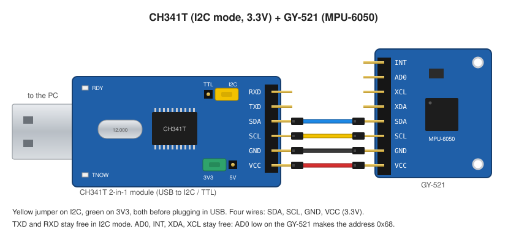
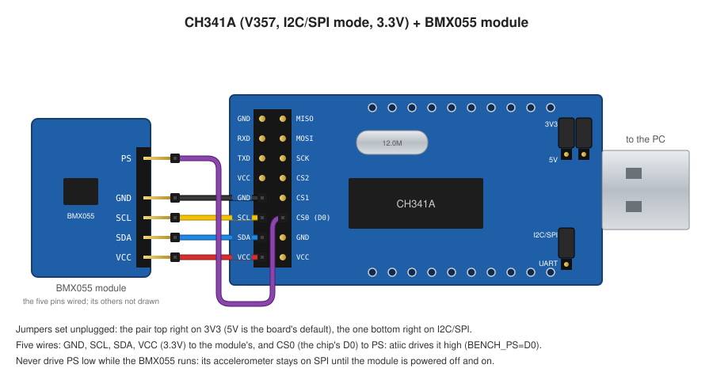
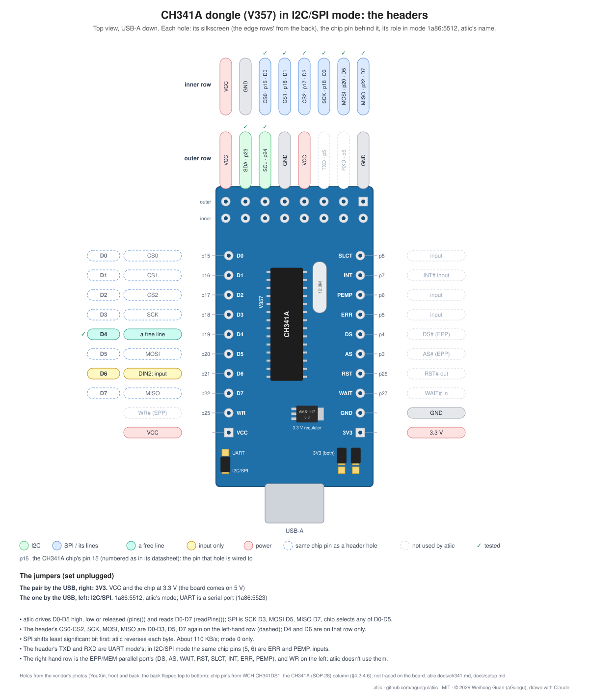

# Setup

The bench atiic's tests run on: a CH341T dongle in I2C mode, an MPU-6050 on
a GY-521 board, four wires, a Linux PC (r8845 here).



The dongle on its own, each header pin's chip pin and its I2C and TTL
roles: [ch341t-board.svg](ch341t-board.svg).

## Parts

- A CH341T "2-in-1" dongle (USB to I2C / TTL): USB-A, a 6-pin header
  (VCC GND SCL SDA TXD RXD), a yellow jumper for the mode (I2C or TTL) and a
  green one for the voltage (3V3 or 5V).
- A GY-521 (MPU-6050): 8 pins VCC GND SCL SDA XDA XCL AD0 INT, its own
  regulator and pull-ups.
- Four female-to-female jumper wires.

## The jumpers, before plugging in

The CH341T reads its mode when it powers up: set both jumpers with the
dongle unplugged.

- **Yellow on I2C.** On TTL the dongle is a serial port instead, and atiic
  can't open it.
- **Green on 3V3.** VCC then gives 3.3V, and SDA/SCL swing to 3.3V: the
  CH341's SDA and SCL pull up to its own supply, and the MPU-6050 is a 3.3V
  part.

## Wiring

| CH341T | GY-521 | wire |
|---|---|---|
| SDA | SDA | blue |
| SCL | SCL | yellow |
| GND | GND | black |
| VCC | VCC | red |

TXD and RXD stay free (UART only). On the GY-521, AD0, INT, XDA and XCL stay
free: AD0 is pulled low on the board, so the MPU-6050 answers at 0x68 (0x69
with AD0 tied to VCC).

## The PC (Linux)

1. Plug the dongle in. In I2C mode it's `1a86:5512`:

   ```
   $ lsusb | grep 1a86
   Bus 001 Device 025: ID 1a86:5512 QinHeng Electronics CH341 in EPP/MEM/I2C mode, EPP/I2C adapter
   ```

   No `5512` but a new `/dev/ttyUSB*`: the yellow jumper is on TTL.

2. Give the device to your user with a udev rule (here the group `uucp`; use
   one you're in, `id` lists them), in `/etc/udev/rules.d/99-ch341.rules`:

   ```
   SUBSYSTEM=="usb", ATTRS{idVendor}=="1a86", ATTRS{idProduct}=="5512", GROUP="uucp", MODE="0660"
   ```

   then `sudo udevadm control --reload && sudo udevadm trigger`, or replug.
   The kernel's `spi-ch341` binds to the dongle on every plug; atiic
   detaches it when it opens the dongle ([ch341.md](ch341.md)).

3. Node 22 or newer, then in atiic:

   ```
   npm install
   npm test              # the host tests, no hardware
   npm run test:board    # the CH341 and the IMU on this bench
   npm run test:advanced # measurements: how much data the IMU gives (about 20 s)
   ```

   `test:board` scans the bus and expects the IMU at 0x68 and nothing
   else, reads it at rest (about 1 g, at any tilt; a gyro already settled
   right after `init()`) and runs its FIFO at 1 kHz for 300 ms.
   `test:advanced` measures what the bus takes off the IMU, polling and
   by its FIFO from 1 to 8 kHz, prints the table and holds the limits seen.
   Keep the module still while they run.

## Another IMU: the MPU-6500

The tests read WHO_AM_I at 0x68 before they start and run the tests of the
chip they find, skipping the other's with the reason (`no MPU-6050 on the
bench (0x68: WHO_AM_I 0x70)`). The other chip so far: a board sold as
GY-9250, which carries an MPU-6500 (WHO_AM_I 0x70), not the MPU-9250 (0x71)
the name says: nothing answers at 0x0C, where an MPU-9250's magnetometer
would, even with the bypass on. Wired the same: its VCC, GND, SCL and SDA to
the dongle's.

## Another bench: a CH341A and a BMX055



Bosch's 9-axis BMX055 is three chips at three addresses: the accelerometer
at 0x18 or 0x19, the gyro at 0x68 or 0x69, the magnetometer at 0x10-0x13
(r8845's module, a CJMCU-900F: 0x19, 0x69, 0x13). The CJMCU-900F's pins,
top to bottom: 3V3, GND, SCL, SDA, PS, SDO1, SDO2, CSB1, CSB2, CSB3 (SDO1/2
and CSB1-3 set the chips' I2C addresses, or are SPI's chip selects). atiic drives all three (`Bmx055Accel`,
`Bmx055Gyro`, `Bmx055Mag`); the tests find each by its chip ID (the
magnetometer's reads only once its power bit is set).

Its **PS** pin picks the interface: high for I2C, low for SPI. Left floating
the module answered nothing on I2C. A wire to VCC does; on r8845 a CH341A
line drives it instead, which is why this bench uses the CH341A: it brings
more of the chip's lines out.

### The dongle: the V357 CH341A



The USB plug on the right, a 2x8 header on the left, and two rows of 10
holes along the edges, named on the back (the back is the front flipped
top to bottom): along the top edge SLCT, INT, PEMP, ERR, DS, AS, RST,
WAIT, GND, 3V3, the parallel port's; along the bottom D0-D7, WR, VCC. D4,
the e-papers' BUSY and the SPI benches' NCS or PS, is the bottom edge's
fifth hole: it's on no header pin. The 2x8 header:

| Outer column | Inner column |
|---|---|
| GND | MISO |
| RXD | MOSI |
| TXD | SCK |
| VCC | CS2 (the chip's D2, pin 17) |
| GND | CS1 (the chip's D1, pin 16) |
| SCL | CS0 (the chip's D0, pin 15) |
| SDA | GND |
| VCC | VCC |

Set the jumpers with it unplugged:

- **The pair top right: 3V3.** The board comes on 5V; the BMX055 is a 3.3V
  part (3.6V at most).
- **The one bottom right: I2C/SPI** (UART is the serial port, 1a86:5523).

### Wiring

| CH341A header | CJMCU-900F |
|---|---|
| VCC (outer, row 4) | 3V3 |
| GND (outer, row 5) | GND |
| SCL (outer, row 6) | SCL |
| SDA (outer, row 7) | SDA |
| CS0 (inner, row 6) | PS |

The four in the same order on both boards, so their wires run side by side.
SDO1, SDO2 and CSB1-CSB3 stay free (as this module leaves them, the chips
answer at 0x19, 0x69 and 0x13).

### PS from D0

Put `BENCH_PS=D0` in an untracked `.env.local` in atiic: `npm run
test:board` drives D0 high before anything looks for a chip, and the CH341
holds it while it stays plugged in (each replug: run the tests or drive it
again, `bus.pins({ D0: true })`). Never drive PS low while the BMX055 runs:
the gyro and the magnetometer come back when it goes high again, but the
accelerometer stays on SPI until the module is powered off and on.

## A display on SPI: an ST7735S

The same CH341A, still in I2C/SPI mode at 3.3V, drives a 0.96" 80x160 IPS
module (ST7735S, 4-wire SPI). Its pins to the header's inner column:

| module | CH341A |
|---|---|
| GND | GND |
| VCC | VCC (3.3V) |
| SCL | SCK |
| SDA | MOSI |
| RES | CS0 (D0) |
| DC | CS1 (D1) |
| CS | CS2 (D2) |
| BLK | VCC (3.3V): the backlight always on |

The module sends nothing back: MISO stays unwired. Its RES and DC aren't
chip selects; atiic drives them as plain lines. On r8845 `.env.local` has
`BENCH_ST7735=res=D0,dc=D1,cs=D2`; the board test leaves a white border on
black with red, green and blue squares. This panel: RGB565, BGR order, no
inversion, 24 columns in (`new St7735s(bus)`'s defaults).
Colours are `0xRRGGBB`; `{ bits: 12 | 16 | 18 }` picks the pixel format
(16 by default): 12 bits is the quickest (a screen in 174 ms on r8845) and
shows a ramp in 16 steps, 18 the smoothest (341 ms).
`scrollArea()`, `scroll(n)` and `scrollRow(n)` use the controller's
scrolling: a strip chart draws one new row a step (4.2 ms on r8845, about
240 steps a second) instead of a whole screen.

> **Scrolling goes one way only.** It moves along the panel's scan lines,
> as the glass is wired; MADCTL can't turn it sideways (MV changes how
> pixels are written, not how the panel scans; ML only reverses it). The bar
> modules, held landscape, scroll leftwards; the round GC9A01, as it sits,
> scrolls upwards (146 rows a second). For a leftward scroll on the round
> one, turn it a quarter counter-clockwise: being round, it looks the same.

The same wiring drives a 1.45" 60x160 IPS module on a GC9107 (`Gc9107`,
`BENCH_GC9107=res=D0,dc=D1,cs=D2`): its panel needs the chip's inner
registers set (Espressif's values, sent by `init()`; without them a white
haze over a quarter of the screen), then shows inverted unless INVON; BGR,
34 columns in.

And a round 240x240 IPS module, 32.4 mm across, on a GC9A01 (`Gc9a01`,
`BENCH_GC9A01=res=D0,dc=D1,cs=D2`): the chip's inner registers set by
`init()` (Espressif's values), inverted, BGR, its columns mirrored
(`mirrorX`). A whole frame is 115,200 bytes: about a second over the CH341,
a scrolled strip chart's row 10.8 ms.

### The round module: a rectangle behind a circle

The GC9A01 doesn't know it's round. Its memory is a rectangle (320x240;
the module uses 240x240 of it), it scans all of it, and every window,
fill and frame is a rectangle of pixels. The glass shows the circle inside:
the rest is drawn and never seen.

- **What shows:** 45,244 of the 57,600 pixels, 78.5% (the pixels whose
  centres lie within 120 of the centre, 119.5, 119.5). A ring drawn at the
  memory's edge shows whole on r8845's module: the circle touches all four
  sides.
- **What's sent anyway:** a 16-bit frame is 115,200 bytes, 24,712 of them
  for the corners.
- **A row's visible chord** is short near the top and bottom: 22 pixels on
  rows 0 and 239 (columns 109-130), 134 on row 20, all 240 in the middle.
- **The largest rectangle that shows** is the circle's square: 169x169,
  half the memory. Text and boxes belong in it (the board test's card sits
  there); round things (dials, rings, arcs) use the rest.
- **Skipping the corners hardly pays over the CH341.** A window costs its
  commands' round trips (about 4 ms, judging by a strip chart's step) as
  well as its bytes, so drawing in bands, each as wide as its widest row,
  saves at best about 11% (estimated: 12 bands, 97,600 bytes, ~935 ms
  against ~1,050 for the whole frame), and drawing each row's chord alone
  costs more than it saves (240 windows: ~1,780 ms). Send the whole frame,
  or only what changed.
- **Scrolling** moves the whole rectangle: rows pass through the hidden
  corners on their way, and it runs upwards as the module sits (see the
  note above).

All three drivers are `DcsPanel`s: the same calls. Their board tests leave
a card that labels itself: thirds in 12, 16 and 18 bits.

D0 is RES here, so it can't be a BMX055's PS on the same bench: one of the
two moves to another line.

## An e-paper display: an SSD1680

A 1.54" 152x152 black/white e-paper module on an SSD1680, wired as the
displays above (RES D0, DC D1, CS D2, SCK, MOSI, VCC, GND), and its BUSY on
D4: the panel holds it high while it works, and atiic reads it
(`readPins()`, the CH341's status read). On r8845 `.env.local` has
`BENCH_SSD1680=res=D0,dc=D1,cs=D2,busy=D4`.

```js
const epd = new Ssd1680(bus); // 152x152, BUSY on D4
await epd.init();
const frame = blankFrame(152, 152); // a bit a pixel, all white
plot(frame, 152, 10, 10); // black
const ms = await epd.show(frame); // a full update: BUSY high ~2.1 s
plot(frame, 152, 20, 10);
await epd.showPartial(frame); // only what changed, no flash: ~0.59 s
await epd.sleep(); // deep sleep 1: the RAM kept, 1-3 uA (the datasheet)
await epd.wake(); // a HW reset and the settings: partial updates go on
```

Asleep, BUSY stays high and only a HW reset wakes it. The RAM comes
through the sleep and the reset: on r8845's module a partial update right
after a wake (no SWRESET, the previous image not rewritten) moved a square
cleanly. `wake()` without an earlier `sleep()` (the power lost) runs
`init()`, and the next update is a full one.

A full update flashes the panel and takes 2.10 s of BUSY on r8845's module
(plus about 58 ms to send the RAM). A partial update (the chip's display
mode 2, its waveform in the panel's OTP) changes only the pixels that
differ from the last frame shown, without a flash: 588-594 ms, about 1.5 a
second with the RAM writes; eight in a row moving a square left no ghost.
It keeps the last frame in the chip's second RAM, which a three-colour
panel shows red: the driver is for black/white panels. The board test
leaves a card labelled with both times, the second label added by a
partial update.

### A second e-paper: an SSD1681

A 1.54" 200x200 black/white module on an SSD1681, the same wiring and BUSY
on D4 (`BENCH_SSD1681=res=D0,dc=D1,cs=D2,busy=D4`). Its commands and flow
are the SSD1680's: `Ssd1681` is `Ssd1680` with 200x200 as its defaults, and
everything above held on r8845's module first time. Its panel is quicker: a
full update 1.68 s of BUSY, a partial 0.50 s.

### A QR code that stays

`npm run demo:qr [text] [quiet modules]` (`demo/epaper-qr.js`) puts a QR
code on the e-paper, `https://i2c.ninja` unless told otherwise: the smallest
version that holds the text at error correction M, its modules as big as
fit, then the panel asleep. E-paper holds its picture with no power, so it
stays readable unplugged. On r8845's module `https://i2c.ninja` is version
2 (25x25), 6 pixels a module, 150 of the 152 pixels: with no quiet zone of
its own it scans fine on a phone, the panel's white surround serving as
one. Longer text, smaller modules (no quiet zone; `qrcode-generator`'s
capacities, bytes at error correction L / M):

| px a module | version | code | bytes L / M |
|---|---|---|---|
| 6 | 2 | 150 px | 32 / 26 |
| 5 | 3 | 145 px | 53 / 42 |
| 4 | 5 | 148 px | 106 / 84 |
| 3 | 8 | 147 px | 192 / 152 |
| 2 | 14 | 146 px | 458 / 362 |

2 pixels (about 0.36 mm a module) still scans on a phone: 355 bytes as
version 14-M did on r8845's module. Past a version's capacity the code
jumps a version and may drop to fewer pixels a module: 374 bytes made
version 15 (77 modules), 1 pixel each, 77 pixels across. The demo warns when that
happens: the bytes, what the version below holds, and how many to cut to
get the bigger modules back. On the 200x200 SSD1681, 2 pixels a module
reach version 20 (97 modules, 194 pixels): 666 bytes at M, and it scans
(about 0.28 mm a module); 690 bytes went to version 21 at 1 pixel. `qrcode-generator` (MIT) encodes, as a dev dependency of the demo
only.

## A reflective mono TFT: an ST7302

A 2.13" 122x250 module on an ST7302, wired as the displays above (RES D0, DC
D1, CS D2), with no BUSY (`BENCH_ST7302=res=D0,dc=D1,cs=D2`). It looks like
e-paper but isn't: no backlight, very low power, and the picture goes when
the power does. A frame is in the RAM the moment it's sent (4,125 bytes, 38
ms over the CH341), and the glass shows it at the frame rate.

```js
const lcd = new St7302(bus); // upright: 122 wide, 250 tall
await lcd.init(); // low power mode, 4 Hz
const frame = blankFrame(122, 250); // the e-papers' frames: a bit a pixel, 1 white
plot(frame, 122, 10, 10);
await lcd.show(frame);
await lcd.frameRate(1); // 0.25-8 Hz low power, 16 or 32 high power
```

On r8845's module, a square moving a frame every 100 ms: in high power mode
(16 and 32 Hz) the panel blinked, still pictures too and with either gate
scan, too much to use; in low power mode at 8 Hz it left ghosts,
at 4 Hz it was fine, the default. The set-up's values are
zhcong/ST7302-for-arduino's (MIT); the datasheet names the commands only.
Its RAM packs 12 pixels across by 2 down in 3 bytes; the driver packs the
upright frame for it.

## An IMU over SPI: the MPU-6500

The GY-9250's MPU-6500 speaks SPI as well as I2C (the MPU-6050 doesn't: its
SPI sibling is the MPU-6000). On the CH341A, in I2C/SPI mode at 3.3V:

| GY-9250 | SPI | CH341A |
|---|---|---|
| VCC, GND | | VCC (3.3V), GND |
| SCL | SCLK | SCK |
| SDA | SDI | MOSI |
| AD0 | SDO | MISO |
| NCS | chip select | a free line: D4 on r8845 |

The chip answers on SPI from the first time NCS goes low. atiic's
`SpiRegisters` turns the SPI and the chip-select line into the bus the I2C
drivers use (a read sets bit 7 of the register), so the `Mpu6500` driver
runs unchanged:

```js
const spi = await new SpiRegisters(bus, { cs: 'D4' }).open();
const mpu = new Mpu6500(spi);
await mpu.init(); // WHO_AM_I 0x70 over SPI
```

The MPU-6500 takes register writes at up to 1 MHz on SPI; the CH341's
clock is under that or near it: on r8845 every write read back.

Faster than I2C: polling its 14 data bytes runs ~1830 reads a second (25
KiB/s), and its FIFO keeps gyro alone at 8 kHz without losing a frame (46.5
KiB/s), which the CH341's I2C at 400 kHz can't (it overflows; ~31 KiB/s
seen). Accel and gyro together at 8 kHz (96 KB/s) overflow over SPI too,
the CH341's ~110 KB/s leaving too little room: 88-90 KiB/s get through.
`SpiRegisters` uses the CH341's `spiSelected()`, the chip select low in the
same USB transfer as the bytes (a round trip less: polling ~2080 reads/s,
from ~1830 with `pins()` around each `spi()`). `npm run test:advanced`
measures them all. On r8845 `.env.local` has `BENCH_MPU6500_SPI=cs=D4`.

## The BMX055 over SPI

The BMX055's three chips speak SPI too (BST-BMX055-DS000, Table 61): one
data input (SDI), two data outputs (SDOAM for the accelerometer and the
magnetometer, SDOG for the gyro, each high-impedance unless its chip is
selected), a chip select each, and PS low for SPI. On the CJMCU-900F:

| CJMCU-900F | SPI | CH341A |
|---|---|---|
| 3V3, GND | | VCC (3.3V), GND |
| SCL | SCK | SCK |
| SDA | SDI | MOSI |
| SDO1 and SDO2 | SDOAM, SDOG | both to MISO |
| CSB1 | the accelerometer's select | D0 (CS0) |
| CSB2 | the gyro's select | D1 (CS1) |
| CSB3 | the magnetometer's select | D2 (CS2) |
| PS | low: SPI | D4, driven low (or GND, as the datasheet asks) |

Which CSB is which was read off r8845's module: each select's chip ID
(0xFA on CSB1, 0x0F on CSB2, 0x32 on CSB3 once woken), the other two
silent. atiic's three drivers run unchanged, each on its own
`SpiRegisters`:

```js
await bus.pins({ D4: false }); // PS low: SPI
const acc = new Bmx055Accel(await new SpiRegisters(bus, { cs: 'D0' }).open());
const gyro = new Bmx055Gyro(await new SpiRegisters(bus, { cs: 'D1' }).open());
const mag = new Bmx055Mag(await new SpiRegisters(bus, { cs: 'D2' }).open());
```

The BMX055 board tests run on I2C or SPI, whichever the bench has; on
r8845 `.env.local` has `BENCH_BMX055_SPI=accel=D0,gyro=D1,mag=D2,ps=D4`.

## A pulse oximeter: the MAX30102

A MAX30102 module on the CH341's I2C (VCC, GND, SCL, SDA; it answers at
0x57, part ID 0x15). A red and an IR LED pulse into the skin; the light that
comes back pulses with the blood:

```js
const m = new Max30102(bus);
await m.init(); // SpO2 mode: red and IR, 100 samples a second, 18 bits, ~7 mA
const samples = await m.readFifo(); // [{ red, ir }, ...], 32 at most: read often
const c = await m.temperature(); // its die, 29 ms
```

On r8845's module: nothing on it, red ~7,000 and IR ~2,300 counts (its
cover's light); a fingertip, red ~120,700 and IR ~108,600, the beat a ripple
on top (a rough count: 75 a minute). The driver gives samples; heart rate
and SpO2 are for a page to work out.

## Humidity and distance: an SHT20 and a VL53L1X

Both on the CH341's I2C at once (VCC, GND, SCL, SDA each), on r8845 a
CH341T:

```js
const sht = new Sht20(bus); // 0x40: commands, not registers
await sht.init(); // a soft reset
const { temperature, humidity } = await sht.measure(); // ~115 ms: C, % RH
const tof = new Vl53l1x(bus); // 0x29: 16-bit register addresses
await tof.init(); // ST's ULD sequence; then ranging every ~100 ms
const { distance, status } = await tof.measure(); // mm; status 0 valid
```

- The SHT20 is measured in "no hold master" mode, the datasheet's maximum
  time waited (85 ms T, 29 ms RH), each reading's CRC-8 checked: hold
  master mode would need the bridge to wait on a held-low SCL. r8845's
  reads its user register 0x3A where the datasheet's example shows 0x02
  (reserved bits); the bench knows it by its electronic ID's CRCs.
- The VL53L1X has no public register map: atiic follows ST's Ultra Lite
  Driver (BSD-3) and its 91-byte default configuration, the same bytes
  pre-1.0 atiic used. On r8845: ~1966 mm to the room, ±2 mm, every ~98 ms.
- `configure({ mode, budget, period })` sets the ULD's distance mode
  (`'short'`, `'long'`), timing budget (20 (short only), 33, 50, 100, 200
  or 500 ms: the ULD's values the datasheet, DS12385 3.5.2, allows; the
  ULD's 15 ms short and 20 ms long left out) and the period between readings (the budget by default).
  On dart at r8845, a still target at ~0.94 m: a reading every budget in
  both modes; the readings' sd 4 mm at 15 ms, under 1 mm at 50 ms short and
  200 ms long; long mode at 20 ms read ~6 cm short (1.5.6, before the
  datasheet's minimums were followed).
- `measure()` gives, besides the distance and status, `signal` (kcps of
  its own light back), `ambient` (kcps of the background) and `spads` (the
  SPADs used), as ST's GetSignalRate, GetAmbientRate and GetSpadNb.
  `roi({ width, height, centre })` narrows its view to part of the 16 x 16
  SPADs (4-16 a side; `Vl53l1x.spadAt(row, column)` for a centre, ST's
  table as SparkFun's header has it). At ~1 m on r8845: 16 x 16 215 SPADs
  and ~8.6 Mcps; 8 x 8 53 SPADs and ~2.5 Mcps; 4 x 4 12 SPADs and ~0.6
  Mcps, status 2 (signal fail) every time (the datasheet's table 20: a
  4 x 4 on the optical centre reaches 143-170 cm on white or gray in the
  dark, 45 cm on dark gray; the target's reflectance unknown). `ambient`
  over `spads` is the datasheet's kcps/SPAD: office light ~5, a sunny day
  behind a window 50, direct sun 200.

## An IR thermometer: the MLX90614

An MLX90614 (r8845's: marked BAA, 3 V, single zone) on the CH341's I2C at
0x5A: the temperature of what it looks at, without touching it, and its
own.

```js
const m = new Mlx90614(bus);
await m.init(); // its config read
const { ambient, object } = await m.measure(); // C: itself, what it sees (zone 1)
```

Every word it sends carries a PEC (a CRC-8), checked. Its SMBus runs at
10-100 kHz, and faster upsets the whole bus: at 400 kHz beside it a VL53L1X
stopped answering. The board tests run at the slowest top clock among the
chips on the bench (`chip.maxSclHz`). Single or dual zone is the part
number's (xAx single; xBx, xCx dual): this one's config register says dual,
its can says single, its "zone 2" reads nonsense.

## Humidity again: the AHT21B

Aosong's AHT21B at 0x38 (r8845: on the CH341T):

```js
const a = new Aht21(bus);
await a.init(); // its status must read 0x18: calibrated
const { temperature, humidity } = await a.measure(); // ~80 ms; every 2 s or more
```

Its datasheet (V1.0, May 2021): status by command 0x71, a measurement by
0xAC 0x33 0x00, 7 bytes back with a CRC-8 (from 0xFF). A chip whose status
lacks 0x18 needs Aosong's own initialisation of three registers, which the
datasheet doesn't give: the driver refuses it. On r8845: 28.1 C, 67.7 % RH,
close to the SHT20's beside it.

Tried and set aside: Aosong's AGS10 (a TVOC sensor) wants I2C at 15 kHz or
under and a 3.0 V supply (± 0.1 V); the CH341 goes no slower than 20 kHz,
and the dongle's 3.3 V is over. It didn't answer. Tried again on dart at
10 kHz (2026-11-10), a module with its own regulator and 4.7 k pull-ups:
the module holds SCL low from power-up, past its 120 s preheat, and blocks
the bus for everything else on it (`bus held low: SCL`); with its SCL
unplugged the bus is free. A faulty module or sensor (its datasheet: over
3 V damages it at once); another one to try.

## Colour: the BH1745NUC

ROHM's colour sensor at 0x38 (ADDR low; 0x39 high), on r8845's dart with
an SHT20 at 0x40 beside it (2026-11-10):

```js
const c = new Bh1745(bus);
await c.init({ timeMs: 160, gain: 1 }); // a reset; 160-5120 ms, 1x, 2x or 16x
const { red, green, blue, clear } = await c.measure(); // counts, once VALID
```

Known by its part ID (0x0B in 40h) and ROHM's manufacturer ID (0xE0 in
92h). Counts only: its datasheet (Rev.002) plots the lux and the colour
temperature worked out from the four but gives no formula. On r8845, a dim
room: 4, 8, 5, 0 at 160 ms and 1x; 65, 125, 78, 14 at 16x (15.6-16.3 times);
17, 31, 20, 3 at 640 ms (about 4 times). It shares 0x38 with the AHT21B:
the AHT21B's check now wants its busy bit clear too, since the BH1745NUC
reads 0xFF where the AHT21B's status would be. On the same bus the INA231's
check (a read of 0xFE) is an SHT20's soft reset: the bench looks for the
SHT20 first.

## Current and power: the INA231

An INA231 module (its shunt marked R100: 0.1 ohm) at 0x40, in series with a
load: the shunt's voltage, the bus voltage, and from them current and power.

```js
const ina = new Ina231(bus); // 0x40, a 0.1 ohm shunt, 0.1 mA a count
await ina.init(); // reset, continuous, its calibration (512)
const { bus: v, current, power } = await ina.measure(); // V, A (signed), W
```

Pass `{ shunt, currentLsb }` for another shunt or scale: the calibration is
the datasheet's Equation 1. On r8845: 4.843 V, 13.0 mA, 62.5 mW. Its ID
registers (FEh, FFh) read the INA226's (0x5449, 0x2260), which the INA231's
datasheet doesn't list: the same register map and scales either way.

## A first read

```js
import { openCh341 } from 'atiic/adapters/ch341/node';
import { Mpu6050 } from 'atiic';

const bus = await openCh341(400000); // the MPU-6050 is rated to 400 kHz
console.log(await bus.scan()); // [ 104 ]: 0x68
const mpu = new Mpu6050(bus);
await mpu.init();
console.log(await mpu.measure());
await bus.close();
```
